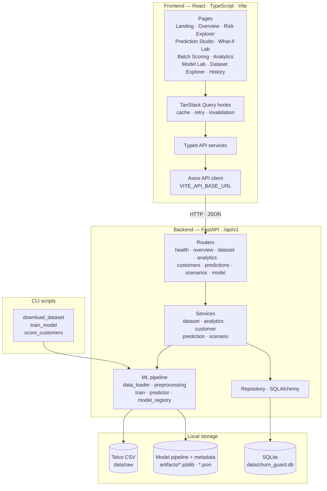

# ChurnGuard AI

Explainable customer churn prediction and retention intelligence — a FastAPI ML backend with a React + TypeScript analytics workspace.

## Architecture

See [`Backend/README.md`](Backend/README.md) and [`Frontend/README.md`](Frontend/README.md) for setup and usage.
